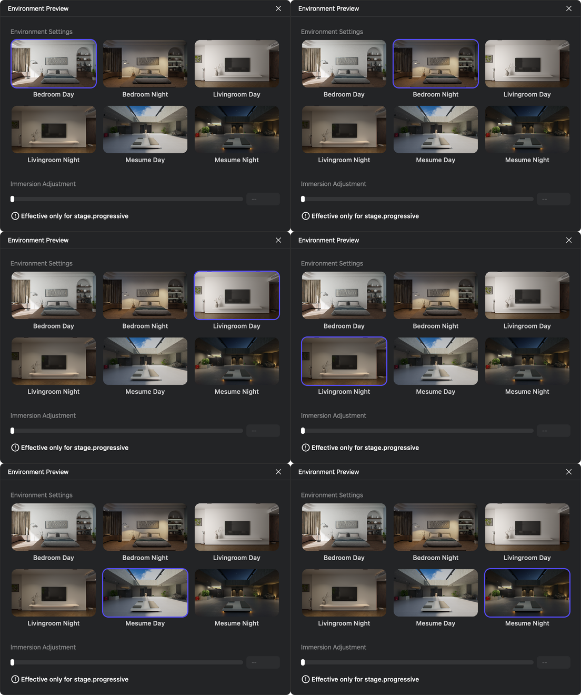

# PICO Emulator 6.0 home-environment recon — 2026-08-29

This is the CP1 evidence bundle for the home-environment fit selector. It was measured on the
macOS PICO Emulator 6.0.0 host window and the cold-booted `emulator-5554` guest. The attached
physical serial was never addressed.

## Runtime binding

- Guest: product `swan`, model `swan_arm64`, API 36, fingerprint build `4399`, boot completed.
- Boot ID: `c0bd8c41-7928-476a-ae8a-a71d89465686`.
- Bridge app: `com.fleet.swanmissiontable`, PID 4936, receipt
  `fcd5d2877dfa8b10ec453a403d0e6c0fb1deff14097f33b7a1be90cd3a8070ce`.
- Every accepted query used consecutive unfiltered non-empty reads before applying the requested
  `TABLE` and `FLOOR` filters. The resulting evidence ceiling is structural.
- The default doctor reported emulator, gRPC, JDK, SDK, adb, and capture prerequisites usable. Its
  camera-calibration check failed because calibration predates this cold boot. Calibration was
  explicitly out of scope, so no metric-camera claim is made.

## Picker inventory and automation result

The 6.0 Environment Preview dialog still contains six tiles:

1. Bedroom Day
2. Bedroom Night
3. Livingroom Day
4. Livingroom Night
5. Mesume Day
6. Mesume Night

The host spelling is `Mesume`. The contact sheet below contains one looked-at dialog capture for
each selected tile; the purple border is on the named target in every panel.

Capture SHA-256:
`402c8c445b8fd1500b5ef5dace36a15b76abcc9be93bcdf643089c6f71592c2c`.

The measured host lane was reliable for this geometry: seven of seven initial target clicks
produced the expected selected border, and the receipt-bound app retained PID 4936. A separate
six-tile durability rerun reproduced every tile's initial selected-frame SHA-256 and recorded the
next periodic scene-context line; see [selection-provenance.json](selection-provenance.json).
This does not establish
reliability on another emulator version, display layout, host OS, or process without Accessibility
permission. A future tool must validate the serial-to-qemu binding and dialog geometry before any
click, then fail closed to a manual-switch instruction when those guards do not hold.

## Capability table

Counts are observed ranges across environment instantiations. A range such as `59..59` means one
accepted instantiation was measured; it is not an exact-count promise. Extents below are SDK
reported local X×Z footprints in metres.

| Tile | Scene ID | Query status | Total anchors | Complete label histogram ranges | FLOOR X×Z | TABLE X×Z |
|---|---|---:|---:|---|---|---|
| Bedroom Day | `XiataAncientPath` | ready | 42..45 | BED 2; UNKNOWN 16..18; CHAIR 0..1; CURTAIN 3; PLANT 4..6; CABINET 1..3; LAMP 5..7; WINDOW 1..2; WALL 2; FLOOR 1; TABLE 0; WALL_ART 1; DOOR 1 | 5.255×2.965 | absent |
| Bedroom Night | `XiataAncientPath` | ready | 41..41 | BED 2; UNKNOWN 17; CURTAIN 2; PLANT 5; CABINET 3; LAMP 6; CHAIR 1; WINDOW 2; FLOOR 2; TABLE 0; DOOR 1 | 5.255×2.965; 4.912×2.867 (thick labeled volume) | absent |
| Livingroom Day | `XiataAncientPath` | ready | 59..59 | SCREEN 1; UNKNOWN 28; LAMP 8; PLANT 2; TABLE 2; CHAIR 3; WALL_ART 1; CABINET 5; WINDOW 2; SOFA 1; FLOOR 1; CEILING 1; WALL 2; DOOR 2 | 2.238×1.502 | 0.176×0.177; 0.783×0.464 |
| Livingroom Night | `XiataAncientPath` | ready | 56..56 | UNKNOWN 25; SCREEN 1; PLANT 3; TABLE 2; CHAIR 3; LAMP 6; WALL_ART 2; WASHING_MACHINE 1; WINDOW 2; SOFA 1; FLOOR 2; WALL 3; CABINET 3; DOOR 2 | 2.238×1.502; 6.868×4.439 | 0.176×0.177; 0.783×0.464 |
| Mesume Day | `XiataAncientPath` | **invalid payload** | raw diagnostic 40..40 | LAMP 14; WALL_ART 2; TABLE 2; UNKNOWN 10; CURTAIN 1; PLANT 2; SOFA 4; STAIRWAY 1; FLOOR 1; CEILING 1; WALL 1; empty 1 | diagnostic only: 2.209×3.295 | diagnostic only: 0.580×0.795; 0.498×0.498 |
| Mesume Night | `XiataAncientPath` | ready | 41..41 | UNKNOWN 11; LAMP 14; SOFA 3; WALL_ART 3; STAIRWAY 1; WALL 2; TABLE 2; CURTAIN 1; CEILING 1; FLOOR 1; PLANT 1; CHAIR 1 | 14.274×16.299 (thick OBB) | 0.580×0.795; 0.498×0.498 |

Mesume Day is excluded from automatic selection. Its stable raw payload contained 39 populated
mesh anchors plus one unlabeled anchor with zero bounds, vertices, and indices. The public
`query_scene_anchors` path rejected it twice as `invalid_payload`; the raw diagnostic is retained
outside the repo at `/tmp/pico-env-recon-2026-08-29/mesume-day-raw-bridge.json`, SHA-256
`09553b9525b67e5e7bbc56fa063406a9a7f0b4c2df3975b0233a4a4c1117f797`. The diagnostic surface
values above are therefore not eligible verification evidence. The compact committed extraction
and its deterministic jq filter are `mesume-day-diagnostic.json` and
`mesume-day-diagnostic-extract.jq`; they preserve the two stable non-empty read projections without
committing the 10.46 MB raw geometry.

## Switch detection

The guest scene identifier comes from `WorldSpace` logcat, not a property or dumpsys field:

- `WorldSpaceDB, getSpace: ... envId=XiataAncientPath ...`
- the same-moment `DataTracking, worktable_status` JSON contains
  `"scene":"XiataAncientPath"`.

The original flagship lines are in [scene-id-source.log](scene-id-source.log); their source was
`/tmp/swanmissiontable-fix-proof/fresh-process-first-60s.log:3909` and `:3911`. The current-boot
[selection provenance](selection-provenance.json) and its exact
[log excerpts](selection-scene-source.log) durably correlate each of the six guarded tile clicks
with the next periodic `WorldSpaceDB` observation. The original two-line source above establishes
the corresponding `DataTracking` field. `dumpsys activity
activities` was used only to bind the foreground component.

`XiataAncientPath` remained constant through every tile and is therefore only a coarse guest-context
check. A switch is considered effective only when all of these hold:

1. the guarded host dialog click completed on the selected tile;
2. `WorldSpace` still reports the expected Default Space scene context;
3. a fresh receipt-bound mesh query is accepted; and
4. its histogram and required-label extents match the target's measured ranges rather than the
   previous environment's snapshot.

This makes the mesh snapshot the discriminating half of verification. A selected-border screenshot
alone is not enough, and the gRPC XrOptions route is not used.

## Evidence files

`capability-summary.json` is the compact source of all ranges, extents, runtime identity, and
eligibility decisions. `selection-provenance.json` binds every picker tile to a later scene-context
observation. The other JSON files are the complete public `query_scene_anchors` results
for each accepted read plus the rejected Mesume Day result. Geometry artifacts are referenced by
path, SHA-256, and byte length inside those results; their temporary multi-megabyte bytes are not
copied into the repository.

## Remaining unverified boundaries

- Picker automation outside this exact macOS/6.0/dialog-geometry lane.
- Any physical-room or headset behavior.
- Mesume Day capability scoring until a lossless public query succeeds.
- Generalization of any single-observation range across another selection or boot.
- Semantic triangle alignment, exact anchor identity, and metric-camera measurements.
